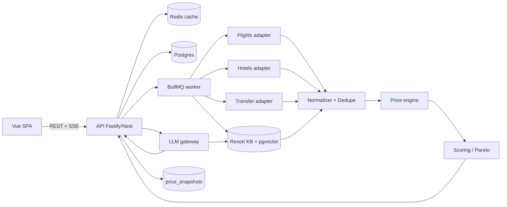

# AiTripDesision — архитектура

## 1. Принципы

- **Числа считает код.** `price-engine` — чистая функция без сети и LLM, покрытая юнит-тестами.
- **LLM изолирован.** Отдельный пакет с промптами, structured output и eval; LLM не генерирует цены.
- **Провайдеры за интерфейсом.** Любой источник цен заменяется без изменения домена.
- **Сначала кэш, потом запрос.** Каждый внешний вызов имеет TTL и слой дедупликации.
- **Прогрессивная выдача.** Результаты стримятся, пользователь не ждёт полный fan-out.
- **Данные с провенансом.** У каждой цены `provider`, `sourceUrl`, `fetchedAt`, `confidence`.

## 2. Стек

| Слой | Выбор | Почему |
|---|---|---|
| UI | Vue 3.5+, `<script setup>`, TS strict | требование проекта |
| Сборка | Vite | быстрый DX, простой SPA |
| Роутинг | Vue Router | стандарт |
| UI-state | Pinia | формы, фильтры, wizard |
| Server-state | TanStack Query (vue-query) | кэш, retry, инвалидация, стриминг |
| Стили | Tailwind + shadcn-vue (reka-ui) | быстрый кастомный UI |
| Графики | ECharts (vue-echarts) | тепловые карты цен, календарь |
| Валидация | Zod + vue-tsc | одна схема на фронт и бэк |
| Бэкенд | Fastify или NestJS (Node 22, TS) | ключи API не на клиенте, fan-out, SSE |
| Очереди | BullMQ + Redis | фоновые снапшоты, алерты |
| БД | PostgreSQL + pgvector | реляционные данные + RAG по курортам |
| LLM | Vercel AI SDK + Zod structured output | провайдер-агностик, стриминг, tool calls |
| Наблюдаемость | Sentry + Langfuse | ошибки и трейсы LLM |
| Деплой | Vercel/CF Pages (web), Fly.io/Railway (api/worker), Neon (PG), Upstash (Redis) | дёшево для MVP |

Для соло-разработки допустима замена `apps/web` + `apps/api` на Nuxt 3 с server routes; архитектура домена от этого не меняется.

## 3. Схема



## 4. Монорепо

```
AiTripDesision/
  apps/
    web/                     # Vue 3 SPA
      src/
        app/                 # router, providers, global styles
        pages/               # search, results, trip, resort
        widgets/             # search-form, results-table, tco-breakdown, price-calendar
        features/            # pick-dates, pick-resorts, tune-budget, compare
        entities/            # trip, resort, offer, transfer
        shared/              # ui-kit, api-client, lib, config
    api/                     # HTTP + SSE + auth
      src/
        modules/search/
        modules/resorts/
        modules/offers/
        modules/ai/
        modules/snapshots/
    worker/                  # BullMQ: fan-out, snapshots, alerts
  packages/
    shared/                  # zod-схемы, типы, price-engine, scoring
    providers/               # flights, hotels, transfers, skipass adapters
    llm/                     # prompts, tools, router, eval
    ui/                      # дизайн-система (если выделяем)
  infra/                     # docker-compose, миграции, IaC
  docs/
```

Фронт — Feature-Sliced Design: `entities → features → widgets → pages`, импорты только вверх.

## 5. Домен и модель данных

```ts
// packages/shared/src/price.ts
type Money = { amount: number; currency: 'EUR' | 'USD' | 'RUB' | 'GEL' };

type TripRequest = {
  dateRange: { from: string; to: string; flexibilityDays: number };
  origin: string;                 // IATA
  countries: string[];
  resortIds: string[];
  pax: { adults: number; children: number };
  level: 'beginner' | 'intermediate' | 'advanced' | 'freeride';
  budget?: Money;
  weights: { price: number; rideTime: number; comfort: number; snow: number };
};

type Offer = {
  kind: 'flight' | 'hotel' | 'skipass' | 'transfer' | 'rental' | 'food' | 'insurance';
  provider: string;
  price: Money;
  per: 'person' | 'room' | 'vehicle' | 'trip';
  deeplink?: string;
  fetchedAt: string;
  confidence: 'exact' | 'estimate' | 'curated';
};

type TripVariant = {
  id: string;
  resortIds: string[];
  legs: Leg[];                    // перелёты
  stays: Stay[];                  // проживание по сегментам
  transfers: Transfer[];
  skipass: SkipassPlan;
  costs: CostBreakdown;           // результат price-engine
  metrics: VariantMetrics;        // rideDays, travelHours, tcoPerRideDay
  score: number;
  explanation?: string;           // от LLM, без цифр
};
```

Основные таблицы: `users`, `searches`, `search_results`, `resorts`, `ski_areas`, `season_windows`, `skipass_products`, `transfer_routes`, `offers`, `price_snapshots`, `resort_documents` (pgvector), `llm_runs`.

Индексы: `price_snapshots(resort_id, kind, captured_at)`, `offers(search_id, kind)`, GIN по `resort_documents.embedding` (HNSW).

## 6. Price engine

```
TCO = Transport + Stay + Skipass + Rental + Transfer + Food + Insurance + Visa + Misc + Buffer
Transport = (out + back + baggage) × pax
Stay      = Σ nights_i × pricePerNight_i × rooms
Skipass   = rideDays × passPrice(resort, season) × pax
Food      = days × perDiem(countryTier) × pax
Transfer  = routePrice(vehicle) / pax  (или фикс за машину)
Buffer    = 8–12% (курс, сборы, багаж)

rideDays        = totalDays − travelDays − restDays(user)
travelHours     = flight + transfer + check-in/out + межкурортные переезды
tcoPerRideDay   = TCO / max(rideDays, 1)
```

Скоринг — взвешенная сумма нормализованных метрик с жёсткими ограничениями (бюджет, даты, уровень, тип скипасса):

```
score = w1·norm(−TCO) + w2·norm(rideDays) + w3·snowReliability
      + w4·resortFit + w5·norm(−travelHours) + w6·comfort
```

Результат — не один победитель, а Pareto-фронт: `cheapest`, `balanced`, `premium`. Профили меняют только веса.

Мультикурортный маршрут: граф `resort → resort` с рёбрами `{hours, cost}`; при 2–4 курортах — полный перебор перестановок с фиксированными ночами (n ≤ 5 дёшево), дальше — эвристика.

## 7. Провайдеры

```ts
interface FlightProvider {
  id: string;
  search(q: FlightQuery): Promise<Offer[]>;
}
// аналогично HotelProvider, TransferProvider, SkipassProvider

interface ProviderResult<T> {
  offers: T[];
  partial: boolean;
  errors: ProviderError[];
}
```

Правила:
- таймаут 6–8 с на провайдера, `Promise.allSettled`;
- нормализация в единый `Offer` + дедупликация по `(kind, route/hotel, dates, price±2%)`;
- приоритет: API → affiliate deeplink → курируемая БД → оценка с `confidence: 'estimate'`;
- circuit breaker и rate-limit на провайдера;
- каждый вызов логируется в `provider_calls` (latency, cost, status).

## 8. Кэш и TTL

| Данные | L2 Redis | L3 Postgres |
|---|---|---|
| Перелёты | 15–30 мин | snapshots 1/сутки |
| Отели | 1–6 ч | snapshots 1/сутки |
| Трансферы | 30 дней | версия по сезону |
| Скипассы | 30 дней | версия по сезону |
| Факты о курортах / RAG | 90 дней | источника |
| LLM-ответы | 24 ч по хэшу запроса | — |

Ключ кэша: `hash(normalizedQuery)`, с версией схемы. Всегда сохраняем `fetchedAt`.

## 9. LLM-слой

Роутинг моделей:
- **cheap/flash** — парсинг запроса, классификация, извлечение сущностей;
- **mid** — RAG-ответы о сезонности, синтез маршрута;
- **strong** — финальное сравнение и рекомендация.

Правила:
- structured output через Zod, retry 1 раз при невалидном JSON;
- tools: `getResortFacts`, `getSkipassPrice`, `getTransferEstimate`, `getPriceHistory` — LLM вызывает их, а не придумывает числа;
- system prompt кэшируется, RAG-контекст ограничен 4k токенов;
- каждый вызов в `llm_runs`: модель, токены, стоимость, latency, `search_id`;
- golden-set из 50 запросов + регрессионный eval в CI (точность фильтров, отсутствие галлюцинаций цен);
- стриминг ответа через SSE.

## 10. API

```
POST /api/v1/searches            → { searchId }
GET  /api/v1/searches/:id/stream → SSE: partial variants
GET  /api/v1/searches/:id        → variants, costs, ranking
POST /api/v1/searches/:id/refresh
GET  /api/v1/resorts?country=&month=
GET  /api/v1/resorts/:id         → факты, сезон, скипасс
GET  /api/v1/price-calendar?resortId=&months=
POST /api/v1/ai/parse            → structured filters
POST /api/v1/ai/compare          → объяснение (SSE)
GET  /api/v1/trips/:shareId      → shareable state
```

Версионирование через `/v1`, OpenAPI генерируется из Zod-схем.

## 11. Фронтенд

- Wizard: даты → направление/курорты → вылет → люди/уровень → бюджет.
- Результаты: таблица вариантов (TCO, цена дня катания, часы в дороге, дни катания), карточки, разбивка стоимости, сравнение 2–4 вариантов бок о бок.
- Прогрессивная загрузка: skeleton по провайдерам, плашка «цены обновлены N минут назад».
- Состояние поиска в URL (shareable), тяжёлые данные — в TanStack Query.
- Доступность: клавиатурная навигация, контраст, ARIA для таблиц.
- Тесты: Vitest для `price-engine`/утилит, Playwright для сценария «запрос → варианты → сравнение».

## 12. Безопасность и юридика

- Все ключи только на сервере; клиент ходит через BFF.
- Rate-limit по IP/сессии, CAPTCHA на анонимные поиски при злоупотреблении.
- Никаких платёжных данных; бронирование — только deeplink на провайдера.
- Дисклеймер: сервис не туроператор, цены справочные, проверяйте на сайте провайдера.
- Раскрытие affiliate-ссылок.
- GDPR/152-ФЗ: минимум PII, e-mail только для алертов с явным согласием.

## 13. Порядок сборки

1. `packages/shared`: схемы + `price-engine` + тесты.
2. `packages/providers`: один flight-adapter на реальном API.
3. `apps/api`: `POST /searches` + SSE + кэш.
4. `apps/web`: wizard + таблица на реальных данных.
5. LLM-парсинг и объяснение, затем RAG.
6. `price_snapshots` и календарь цен — как только пойдёт трафик.
