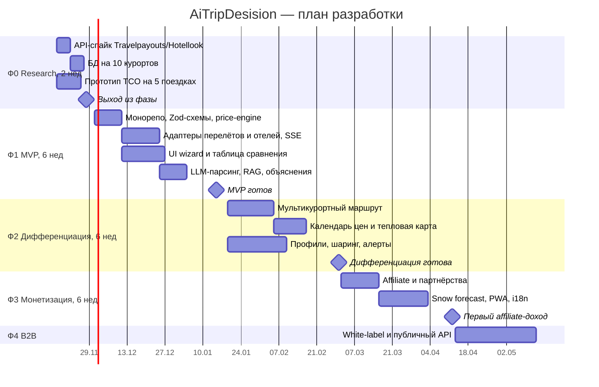
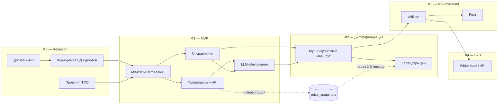

# AiTripDesision — роадмап

## 1. Продукт в одном абзаце

Сервис помогает выбрать сноуборд/горнолыжную поездку под бюджет: пользователь задаёт месяцы, страну/курорты, город вылета и ограничения, а система собирает **полную стоимость владения поездкой (TCO)** — перелёт, проживание, скипасс, прокат, трансфер, еда, страховка — считает **полное время в дороге и дни катания**, и показывает 3–5 объяснимых вариантов (дешёвый / сбалансированный / премиум) с ссылками на бронирование.

Ключевая ценность — не «поиск отелей», а **сравнение вариантов по цене одного дня катания** и по совокупности факторов. Это decision-support, а не OTA.

## 2. Позиционирование и конкуренты

| Категория | Игроки | Что дают | Чего не дают |
|---|---|---|---|
| Авиаметапоиск | Skyscanner, Aviasales, Google Flights, Kiwi | Цены на билеты, календарь «весь месяц» | Отели, скипасс, трансфер, TCO |
| Отели | Booking, Ostrovok, Airbnb, Google Hotels | Проживание | Перелёт, скипасс, маршрут |
| Пакетные туры | Sletat, Level.Travel, Travelata, Onlinetours | Готовые пакеты «перелёт+отель» | Гибкий маршрут, скипасс, сравнение по дням катания |
| Ски-специфика | SnowPak, Iglu Ski, Ski Solutions, PowderBeds, SkiBro | Пакеты по курортам, иногда скипасс | Агрегация цен, RU-направления, AI-подбор |
| Ски-сообщества | Ski.ru, форумы, Telegram | Отзывы, логистика | Цены в реальном времени |

**Вывод:** прямого конкурента с TCO + AI-подбором + мультикурортным маршрутом нет. Ближайшие — пакетные туроператоры и SkiBro/SnowPak. Ниша узкая, но защищаемая за счёт: (а) нормализованной базы скипассов/трансферов, (б) накопленной истории цен, (в) скоринга «цена дня катания».

**Главный риск позиционирования:** если уйти в «ещё один поиск отелей» — проиграем Booking. Держим фокус на решении, а не на инвентаре.

## 3. Границы MVP

В MVP **входит:**
- форма запроса: диапазон дат (гибкость ±N дней), страна/регион, 1–3 курорта, город вылета, кол-во человек, уровень, бюджет;
- AI-парсинг свободного запроса → структурированные фильтры;
- перелёты (2–3 провайдера, только deeplink, без бронирования);
- отели (deeplink/affiliate), 1–2 провайдера;
- скипасс и трансфер — **курируемая БД** на 10–15 курортов, не парсинг;
- калькулятор TCO + сравнение вариантов + «цена дня катания»;
- AI-объяснение: сезонность, почему вариант дороже/дешевле, что можно урезать;
- сохранение поиска по ссылке (shareable state), без авторизации.

В MVP **не входит:** бронирование и платежи, авторизация, алерты, мобильное приложение, реальные трансферы по API, snow forecast.

## 4. Ключевые продуктовые решения

1. **Все числа считает код, не LLM.** LLM — только парсинг, объяснения, синтез маршрута. Любая цифра приходит из БД с `source` и `fetchedAt`.
2. **Сразу собираем историю цен.** Таблица `price_snapshots` наполняется с первого дня — через 2–3 месяца она даёт календарь «когда дешевле», который нельзя купить.
3. **Курируемые данные вместо скрапинга.** Скипассы, трансферы, сезонные окна — ручная БД с версионированием по сезону.
4. **Три варианта вместо одного «лучшего».** Pareto-фронт по цене/времени/качеству понятнее и честнее, чем одна магическая цифра.
5. **Честные цены:** метка «цена на 12.11, может измениться», кнопка «обновить», диапазон ±10% для отелей.

## 5. Экономика: токены и API-вызовы

### LLM на одну сессию подбора

| Шаг | Вход, ток. | Выход, ток. | Модель |
|---|---|---|---|
| Парсинг запроса → фильтры | 600 | 200 | cheap |
| Подбор курортов (RAG по БД) | 3 000 | 600 | cheap/mid |
| Сезонность и «когда дешевле» | 2 000 | 700 | cheap |
| Синтез мультикурортного маршрута | 4 000 | 1 200 | mid/strong |
| Итоговое сравнение и рекомендации | 4 000 | 1 000 | strong |
| **Итого** | **~14k** | **~3,7k** | |

При ценах класса mini/flash (~$0.15–0.6 за 1M) — **$0.004–0.01 за сессию**. При premium-модели на финальном шаге (~$2.5/$10 за 1M) — **$0.05–0.08**. То есть 10 000 сессий/мес = **$50–800** в зависимости от роутинга моделей.

Снижение расхода:
- кэш фактов о курортах и сезонности (TTL 90 дней) — убирает 60–80% вызовов;
- cheap-модель для парсинга/классификации, strong — только финальный синтез;
- prompt caching системных промптов и RAG-контекста;
- дедупликация одинаковых запросов (Redis, 24 ч).

### Внешние API

| Данные | Модель доступа | Ориентир |
|---|---|---|
| Перелёты | Travelpayouts / Aviasales affiliate | бесплатно, доход с клика |
| Отели | Hotellook/Booking affiliate или Amadeus Self-Service | $0.01–0.05 за поиск |
| Трансферы | GetTransfer/KiwiTaxi affiliate + эвристика | бесплатно / лид |
| Гео, POI | Google Places / OSM | $5–17 за 1000 запросов |
| LLM | по токенам | см. выше |

Экономика сходится на affiliate-модели (CPA за бронирование), а не на подписке. При 1–3% конверсии в клик по affiliate и среднем чеке €800–1500 это единицы евро с брони.

## 6. Риски

| # | Риск | Влияние | Митигация |
|---|---|---|---|
| 1 | Нет доступа к API отелей/перелётов, ToS запрещает скрапинг | Высокое | Adapter-слой, 2+ провайдера, deeplink вместо брони, без скрапинга в MVP |
| 2 | Зависимость от одного affiliate (Travelpayouts/Booking) | Высокое | Минимум два канала, абстракция провайдера, прямые партнёрства с курортами |
| 3 | Данные скипассов не структурированы | Среднее | Ручная БД, 10–15 курортов, обновление раз в сезон, поле `verifiedAt` |
| 4 | LLM выдумывает цены и сезоны | Высокое | Числа только из БД, валидатор ответов, LLM не имеет права генерировать цифры |
| 5 | Волатильность цен, устаревший кэш | Среднее | `fetchedAt`, TTL по типу данных, кнопка refresh, диапазоны |
| 6 | Санкции/платежи/валюта для RU-пользователя | Высокое | Мультивалютность, ручной ввод курса, не хранить платёжные данные |
| 7 | Сезонность бизнеса (только зима) | Среднее | Тот же движок для летнего трекинга/вело/серфинга в фазе 3 |
| 8 | Расползание скоупа в OTA | Высокое | Жёсткая граница: никаких платежей и брони в MVP |
| 9 | Стоимость data-вызовов растёт с fan-out | Среднее | Лимит провайдеров на запрос, кэш, батчинг, прогрессивная выдача |
| 10 | Доверие к «AI-совету» | Среднее | Объяснимость: показывать, из чего сложилась цена и почему вариант рекомендован |

## 7. Фазы

### Фаза 0 — Research spike (1–2 недели)
- Проверить доступ к 2–3 affiliate API (Travelpayouts, Hotellook, Amadeus sandbox).
- Собрать вручную БД по 10 курортам: скипасс, трансфер, сезонные окна, цены еды.
- Прототип формулы TCO в таблице, проверить на 5 реальных поездках.
- **Exit:** есть 2 рабочих источника цен и подтверждённая формула, ошибка TCO < 15% на ручной проверке.

### Фаза 1 — MVP (5–6 недель)
- Монорепо, shared-схемы (Zod), price-engine с тестами.
- API: `POST /searches`, SSE-выдача, adapter-слой перелётов и отелей.
- UI: форма запроса, таблица сравнения, карточка варианта, TCO-разбивка.
- AI: парсинг запроса, RAG по курортам, финальное объяснение.
- `price_snapshots` пишется с первого дня.
- **Exit:** 10 тестовых запросов дают 3+ жизнеспособных варианта, полный цикл < 20 с (стриминг), стоимость сессии < $0.1.

### Фаза 2 — Дифференциация (5–6 недель)
- Мультикурортный маршрут: 2–4 курорта, ночи, трансферы между ними, оптимизация перебора.
- Календарь цен и тепловая карта «месяцы × направления» на накопленных снапшотах.
- Настройка профиля (бюджет, комфорт, фрирайд) и весов скоринга.
- Shareable-ссылки, сохранённые поездки, e-mail алерты по цене.
- **Exit:** пользователь может собрать маршрут «2 курорта + переезд» и увидеть его TCO и время в дороге.

### Фаза 3 — Монетизация и рост (4–6 недель)
- Affiliate-вставки, партнёрства с курортами/школами/прокатами.
- Snow forecast и snow history, отзывы, фото.
- PWA, мобильная вёрстка, локализация (RU/EN).
- Летний режим (трекинг/вело) на том же движке.
- **Exit:** первый affiliate-доход, retention на сохранённых поисках.

### Фаза 4 — B2B / масштаб
- White-label для туроператоров и ски-клубов, публичный API, сообщество и UGC.

## 8. Метрики

- Time-to-decision (от запроса до клика по варианту);
- доля поисков с ≥3 жизнеспособными вариантами;
- CTR в affiliate и конверсия в бронирование;
- LLM-стоимость на сессию и на бронирование;
- точность TCO против фактических чеков (выборочный аудит);
- retention: возвраты к сохранённым поискам.

## 9. Ближайшие 5 задач

1. Спайк доступа к API: Travelpayouts + Hotellook/Amadeus, зафиксировать лимиты и ToS.
2. Ручная БД на 10 курортов (скипасс, трансфер, сезон, еда) → `packages/shared` схемы.
3. Реализовать и покрыть тестами `calculateTco()` и `scoreVariants()`.
4. Скелет монорепо и `POST /searches` с одним провайдером перелётов.
5. UI-таблица сравнения на мок-данных, затем подключить реальные цены.

## 10. Визуализация плана

Зависимости и критический путь:

`price_snapshots` запускается в Ф1, а ценность (календарь «когда дешевле») появляется только в Ф2 — это единственная зависимость, которую нельзя ускорить деньгами.

